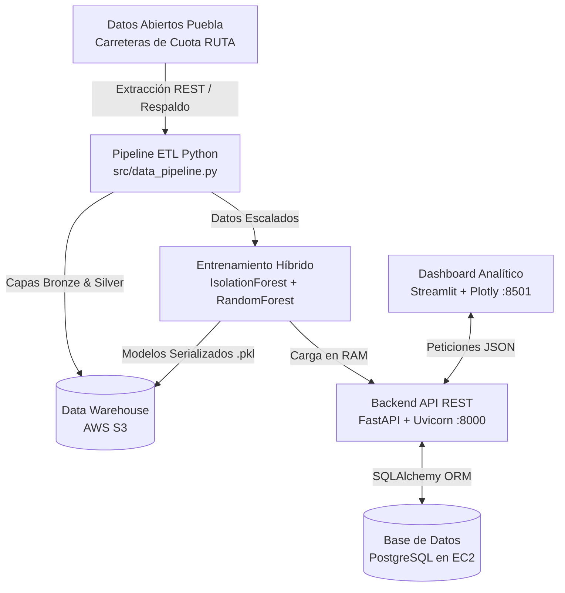

# 🚌 Sistema Predictivo de Demanda y Saturación Crítica — RUTA Puebla

**Institución:** Universidad Tecnológica Bilingüe Internacional y Sustentable de Puebla (UTBIS Puebla)  
**Programa Educativo:** Ingeniería en Desarrollo y Gestión de Software  
**Asignatura:** Extracción de Conocimiento en Bases de Datos  

---

## 1. Problemática y Pertinencia Territorial (Puebla)

La Red Urbana de Transporte Articulado (**RUTA**) moviliza diariamente a cientos de miles de usuarios en la Zona Metropolitana de Puebla. Los picos repentinos de afluencia en estaciones troncales generan saturación de unidades, demoras y afectaciones a la movilidad cotidiana.

Este sistema consume datos operativos de **Carreteras de Cuota Puebla** (Portal de Datos Abiertos del Gobierno del Estado de Puebla) para detectar anomalías en la demanda y predecir escenarios de saturación crítica, permitiendo optimizar la asignación de unidades articuladas.

---

## 2. Articulación con Criterios Transversales SEAES

* **Compromiso con la Responsabilidad Social:** Aprovecha datos abiertos gubernamentales para mejorar la planeación del transporte público masivo en Puebla sin comprometer datos personales.
* **Inclusión:** Contribuye a garantizar la suficiencia y continuidad del transporte público del que dependen estudiantes, trabajadores y población vulnerable.
* **Excelencia y Vanguardia:** Implementa una arquitectura híbrida de Machine Learning (`IsolationForest` + `RandomForest` optimizado con `GridSearchCV`) desplegada sobre infraestructura Cloud en AWS.

---

## 3. Arquitectura Cloud y Flujo de Datos



---

## 4. Estructura del Repositorio

```text
utbis_ruta_puebla/
├── data/                   # Directorio local temporal para capas Bronze/Silver
├── models/                 # Directorio local para modelos serializados (.pkl)
├── src/
│   ├── database.py         # Configuración SQLAlchemy ORM y modelo PostgreSQL
│   ├── data_pipeline.py    # Extracción API Puebla, limpieza ETL y carga a AWS S3
│   ├── train.py            # Entrenamiento híbrido, StratifiedKFold y GridSearchCV
│   └── main.py             # API RESTful FastAPI (/predict, /schema, /historial)
├── app_streamlit.py        # Interfaz analítica interactiva y visualización Plotly
├── requirements.txt        # Dependencias exactas del entorno Python
├── .env.example            # Plantilla de variables de entorno sin credenciales
├── .gitignore              # Exclusión de archivos sensibles (.env, venv, .pkl, .csv)
└── README.md               # Documentación técnica y arquitectónica
```

---

## 5. Instrucciones de Despliegue y Reproducibilidad

1. **Clonar repositorio y preparar entorno virtual:**
   ```bash
   git clone https://github.com
   cd utbis_ruta_puebla
   python3 -m venv venv
   source venv/bin/activate
   pip install -r requirements.txt
   ```

2. **Configurar variables de entorno:**
   ```bash
   cp .env.example .env
   nano .env
   ```

3. **Ejecutar Pipeline ETL, Entrenamiento Híbrido y Sincronización con S3:**
   ```bash
   python src/train.py
   ```

4. **Iniciar Backend API y Frontend Analítico:**
   ```bash
   uvicorn src.main:app --host 0.0.0.0 --port 8000
   streamlit run app_streamlit.py --server.port 8501 --server.address 0.0.0.0
   ```
